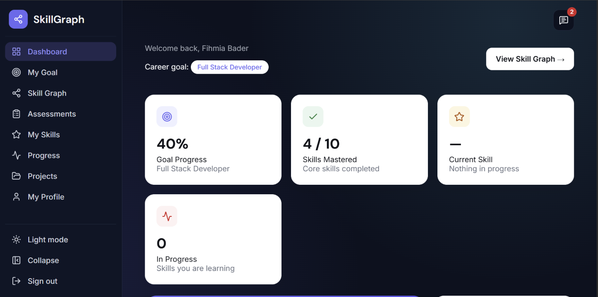
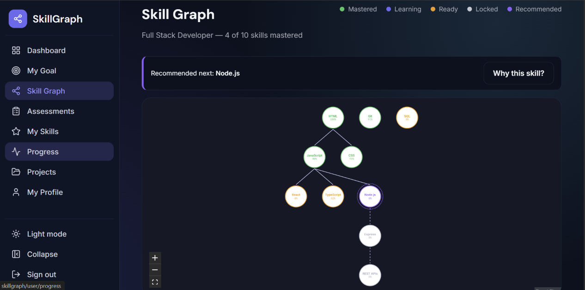
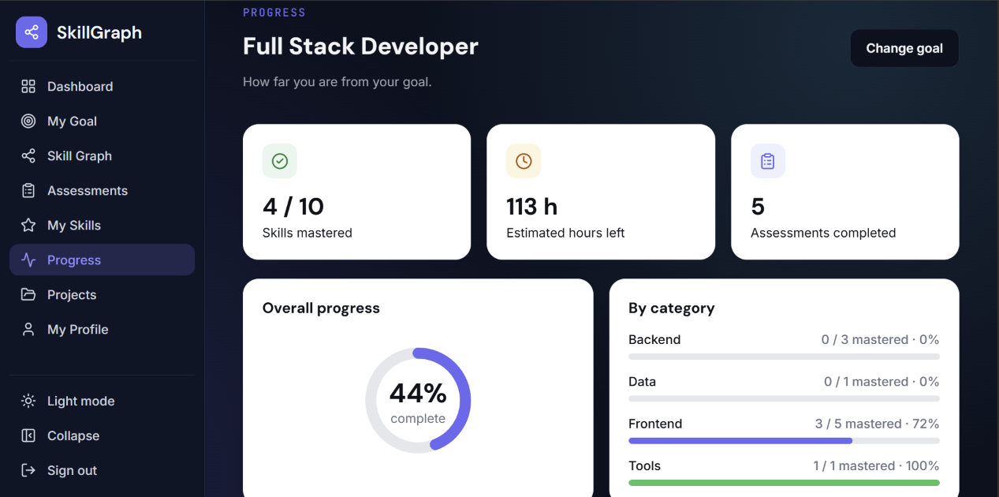

# SkillGraph

SkillGraph turns a career goal into a graph of skills and tells the learner what to study next.
The user picks a goal, takes short adaptive assessments, and the system recommends the
**Next Best Skill** with a clear explanation. After every assessment the plan is recalculated.

## Screenshots






## Features

### For learners

- **Account and session**: register, log in and log out. The login lives in an httpOnly cookie, so a refresh keeps you logged in and nothing is stored in the browser.
- **7 career goals**: Full Stack, Frontend, Backend, Data Analyst, Cybersecurity, UI/UX Designer and DevOps. One generic algorithm serves all of them, nothing is hardcoded per career.
- **Interactive skill graph**: skills are nodes, prerequisites are arrows. Each node shows its state (mastered, ready, locked) and opens a detail panel.
- **Adaptive assessment**: 10 questions per test, picked from a bank of 15 per skill. The difficulty goes up after a correct answer and down after a wrong one. The correct answer is revealed only after the answer is saved.
- **Scoring with confidence**: a difficulty-weighted score per concept, and a confidence value that says how much the result can be trusted. A skill is mastered only with enough mastery and enough confidence.
- **Next Best Skill**: five factors (goal impact, readiness, unlock potential, gap priority, time efficiency) give every ready skill a utility score. The winner comes with a plain explanation: the strongest reasons, how many skills it unlocks and its margin over the runner-up.
- **Automatic replanning**: when an assessment is completed the recommendation is calculated again.
- **Progress page**: percent of the goal, hours remaining, progress per category and recent tests.
- **Changing the goal keeps your progress**: mastery is stored per user and skill, so shared skills are reused and never copied.
- **Memory check (knowledge decay)**: a forgetting curve shows how well you still remember each mastered skill (fresh, fading or due). The skills you forget the most come first, and a review is a normal retake. See [docs/review.md](docs/review.md).
- **Your mentor**: the Dashboard shows the mentors who look after your goal. See [docs/mentors.md](docs/mentors.md).
- **Projects and recommendations**: share a project with a mentor of your goal. The mentor writes a personal recommendation and signs it by drawing the signature. It is the opinion of one person. You can download it as a PDF.
- **Verify a recommendation**: every recommendation has a code such as `SG-7KQ2-M9XD-4TPA`. Anybody can type it on the public page `/verify` (no login) to see the original text and signature.
- **Mentor desk**: mentors see the projects shared with them and write a signed recommendation or decline.
- **Profile**: name, email, password, weekly learning hours and account deletion.
- **Advice from admin**: a message icon with an unread counter, and a window to read and mark messages as read.
- **Light and dark theme**, a landing page, and error states on every page with a global error boundary.

### For admins

- **Dashboard numbers**: totals and users per goal.
- **Users**: search, view the progress of one user (skills, mastery, recent tests), change a role, write advice, delete a user (with safety rules).
- **Questions**: create skills, add and edit questions (4 options, exactly one correct), hide and show questions. A skill always keeps at least 10 active questions.
- **Goal skills**: add or remove a skill in a goal, change its required mastery, importance and hours, and edit prerequisites. Cycles are refused.
- **Mentors**: add a new mentor account (name, email, first password, optional goals) or give an existing user the role MENTOR, and choose the goals each mentor looks after.
- Full rules and API: [docs/admin.md](docs/admin.md).

### Quality

- 255 automated checks: unit tests, real PostgreSQL tests, HTTP tests and a live smoke test ([docs/testing.md](docs/testing.md)).
- `check:seed` and `check:deploy` scripts before every release.
- Numbered database migrations, constraints on every table and indexes for the main queries ([docs/database.md](docs/database.md)).

## Tech stack

| Part | Technology |
| --- | --- |
| Frontend | React, TypeScript, Vite, React Router, Redux Toolkit, React Flow (`@xyflow/react`) |
| Backend | Node.js, Express, TypeScript, JWT in an httpOnly cookie |
| Database | PostgreSQL |

## Project structure

```
backend/
  schema.sql            baseline database schema
  migrations/           numbered SQL changes applied after the baseline
  src/
    config/             env, database pool, migration runner
    middleware/         auth, role check, request validation
    routes/             auth, goals, graph, assessments, recommendations, progress, review, mentors, projects, mentor desk, account, advice, admin, health
    services/algorithm/ pure algorithm code (scoring, adaptive questions, recommendation, explanations, knowledge decay)
    seed/               goals, skills, prerequisites and the question bank
    tests/              unit tests and database tests
frontend/
  src/
    pages/ components/ hooks/ services/ features/ (Redux slices) routes/ styles/
docs/
  algorithm.md          how the recommendation algorithm works
  review.md             knowledge decay and the review queue
  mentors.md            mentors, goals, projects and signed recommendations
  database.md           tables, constraints, indexes, migrations, seed
  admin.md              admin content management and API
  testing.md            every test file and what it covers
  setup.md              step by step setup on a new computer
  demo.md               demo accounts and the presentation scenarios
  deployment.md         backend and frontend deployment, smoke test, troubleshooting
```

## Run it locally

### 1. Database

Create an empty PostgreSQL database named `skillgraph`.

### 2. Backend

```bash
cd backend
npm install
cp .env.example .env        # then edit DATABASE_URL and JWT_SECRET
npm run migrate             # applies schema.sql once, then every file in migrations/
npm run dev                 # http://localhost:3000
```

The server also runs the pending migrations when it starts, so `npm run migrate`
is only needed when you want to run them by hand.

Check that it works: `GET http://localhost:3000/api/health` returns `{ "status": "ok" ... }`.

### 3. Frontend

```bash
cd frontend
npm install
npm run dev
```

The dev server forwards `/api` to the backend (`VITE_API_URL=/api`).
If you use the `http://skillgraph` dev domain, add `127.0.0.1 skillgraph` to the hosts file
and set `CLIENT_URL=http://skillgraph` in `backend/.env`.

More detail: [docs/setup.md](docs/setup.md). Demo accounts for a presentation: `npm run seed:demo`
(see [docs/demo.md](docs/demo.md)).

## Roles and the first admin

Every new account is a `USER`. There are three roles: `USER`, `MENTOR` and `ADMIN`.
Routes under `/admin` answer `401` without a login and `403` for everyone who is not an `ADMIN`.
To make the first admin, run this once in `psql` (then log in again, because the
role is stored inside the login token):

```sql
UPDATE users SET role = 'ADMIN' WHERE email = 'you@example.com';
```

Admins can then change the role of other users (including `MENTOR`) from the Admin page of the app.

## Tests

From the `backend` folder:

```bash
npm run test:unit     # algorithm, explanations, progress, goal change, knowledge decay (no database needed)
npm run test:db       # recommendation flow + constraints, foreign keys, joins, cascades, admin rules, review queue, mentors, mentor accounts, project shares, public verification (needs the migrated database)
npm run test:api      # HTTP tests: auth, 401/403, validation, ownership, assessment flow (the server must be running)
npm test              # test:unit and test:db
```

What each group covers:

| Group | Covers |
|-------|--------|
| `test:unit` | mastered skills are excluded, unmet prerequisites block a skill, unlock comparisons, goal complete, goal change reuses mastery, the recommendation changes after mastery updates, the forgetting curve |
| `test:db` | UNIQUE, FOREIGN KEY, CHECK and enum constraints, ON DELETE CASCADE, the key joins (graph, per-user progress, progress of all goals), admin content and user rules, the review queue, mentors, mentor accounts, project shares, public verification |
| `test:api` | register/login, invalid credentials, missing or invalid JWT (401), USER on admin routes (403), validation (400/404), another user's assessment (ownership), assessment completion updates `user_skills`, structured recommendation explanation, account deletion |

The database and API tests create their own users (`d12test_*`, `apitest_*`) and remove them at the end.

### Data and deployment checks

```bash
npm run check:seed      # reads the database: catalog match, prerequisite cycles, 15 questions per skill (5 easy, 5 medium, 5 hard), one correct option per question
npm run check:deploy    # environment variables, database, migrations and seed
API_URL=https://your-api.example.com/api npm run check:deploy   # also checks a running server
```

Full deployment guide: [docs/deployment.md](docs/deployment.md).

`check:deploy` checks the environment variables (JWT secret, `CLIENT_URL`, `NODE_ENV`), the database connection, the applied migrations, the seed data, and, with `API_URL`, the health endpoint, CORS and the protection of the routes. It exits with an error when something fails.

## API overview

All routes are under `/api`. Everything except `auth` and `health` needs the login cookie.

| Method | Route | What it does |
| --- | --- | --- |
| POST | `/auth/register`, `/auth/login`, `/auth/logout` | Account and session |
| GET | `/auth/me` | Who is logged in |
| GET | `/goals` | List career goals |
| GET, PUT | `/goals/current`, `/goals/select` | Read and choose the current goal |
| GET | `/graph/:goalId` | Skill nodes and prerequisite edges with the user's state |
| POST | `/assessments/start` | Start (or resume) an assessment for a skill |
| POST | `/assessments/:id/answer` | Save one answer, get the next question |
| POST | `/assessments/:id/complete` | Score the assessment and replan |
| GET | `/recommendations/next` | Next Best Skill with its explanation |
| GET | `/progress` | Progress of the current goal (percent, hours left, categories, recent tests) |
| GET | `/progress/goals` | Progress in every goal (a new goal starts with the skills you already know) |
| GET | `/review` | Memory health of the mastered skills of the current goal (knowledge decay) |
| GET | `/mentors/mine` | The mentors of the goal the user follows (names only) |
| GET | `/verify/:code` | Public (no login): the recommendation behind a code, to check that it is real |
| POST | `/projects` | Share a project with a mentor of the current goal |
| GET | `/projects/mine` | My shared projects, with the signed recommendation when there is one |
| DELETE | `/projects/:shareId` | Take back a project that is waiting or was declined |
| GET | `/mentor/requests` | Mentor only: the projects shared with me |
| POST | `/mentor/requests/:shareId/recommendation`, `/decline` | Mentor only: sign a recommendation, or decline with an optional note |
| GET | `/advice` | The advice an admin wrote for the logged-in user, with the unread counter |
| PATCH | `/advice/:adviceId/read`, `/advice/read-all` | Mark advice as read |
| GET, PUT | `/account/profile` | Name, email and weekly learning hours |
| PUT | `/account/password` | Change password |
| DELETE | `/account` | Delete the account |
| GET | `/health` | Server status |
| GET | `/admin/stats` | Admin only: totals and users per goal |
| GET | `/admin/users` | Admin only: users with their goal (`?limit=&offset=`) |
| PUT | `/admin/users/:userId/role` | Admin only: change a role to `USER`, `MENTOR` or `ADMIN` (not your own) |
| POST | `/admin/mentors` | Admin only: create a new account with the role `MENTOR` |
| | `/admin/skills`, `/admin/questions`, `/admin/goals`, `/admin/mentors`, `/admin/users/:userId` | Admin only: content, mentor and user management, listed in [docs/admin.md](docs/admin.md) |

The algorithm is explained in [docs/algorithm.md](docs/algorithm.md).

## Team

### Arkan Mohamad Issa: frontend, algorithm, PostgreSQL, assessment

**Frontend**
- Built the React and TypeScript app: routing with protected pages, the Redux slices and typed hooks, the API service layer, the design tokens and the light and dark theme.
- Built the pages: landing, login and register, goal selection, dashboard, skill graph, assessment (start, quiz, results), progress, my skills, my goal and profile.
- Built the skill graph with React Flow: node states, the detail panel and the layout.
- Built the admin screens: questions, goal skills, users, and the modals for editing, viewing a user and writing advice.
- Built the advice icon and window for learners, and the error states and error boundary.

**Algorithm and assessment**
- Designed and wrote the skill states, the five factors, the utility formula, the explanation of each recommendation and the replanning after an assessment.
- Designed and wrote the adaptive assessment: difficulty targeting, concept coverage, difficulty-weighted scoring and the confidence formula.
- Wrote the goal change logic (progress is stored per user and skill and reused across goals) and the progress summary.

**PostgreSQL**
- Designed the schema, the constraints and the indexes, and wrote the migrations and the migration runner usage.
- Wrote the seed: 7 goals, 44 skills, 43 prerequisites and the question bank (15 questions per skill), plus the validator and `check:seed`.

**Tests and docs**
- Wrote the unit and database tests and the documentation in `docs/`.

### Fihmia Bader: Express infrastructure, authentication, roles, deployment

- Set up the Express server and its structure (config, middleware, routes).
- Built registration, login and logout with bcrypt and a JWT in an httpOnly cookie, and the role checks (`USER` and `ADMIN`, 401 and 403).
- Wired the routes of the API and the request validation.
- Prepared the deployment of the backend and the frontend, the production scripts and the deploy checks.
- Reviewed every pull request before it was merged into `main`.

## Roadmap

Ideas for the next versions, roughly in the order we would build them:

1. **Code review and practical exercises**: the mentor reviews code a learner sends and writes hands-on exercises for a skill (not multiple choice).
2. **What-if simulator**: "what happens to my plan if I master this skill next?" Show the new recommendation and the new goal percent before the user studies.
3. **Smart study plan**: turn the weekly learning hours of the profile into a week-by-week plan that follows the recommendation order.
4. **Weak concepts**: show the concepts inside a skill where the user answered wrong most often, and suggest what to revise.
5. **Goal match**: compare the user's current skills with all 7 goals and suggest the goal that is closest to them.
6. **Review reminders**: email or in-app reminders when a mastered skill becomes due in the Memory check.
7. **Learning resources**: links to a course, an article or an exercise for every skill, chosen by admins.
8. **Admin analytics**: the hardest and the most skipped questions, the skills where users get stuck, and the average time per test.
9. **Question import**: upload many questions at once from a CSV file in the admin page.
10. **AI layer (optional)**: a plain-language explanation or a study tip written by a language model. The decision always stays with the transparent formula.
11. **Achievements and streaks**: small rewards for finishing assessments and reviews on time.
12. **Automated frontend tests and CI**: component and end-to-end tests, and a GitHub Actions run of `npm test` and `npm run build` on every pull request.
13. **More goals and skills**: new careers and deeper skill trees, added from the admin page without code changes.