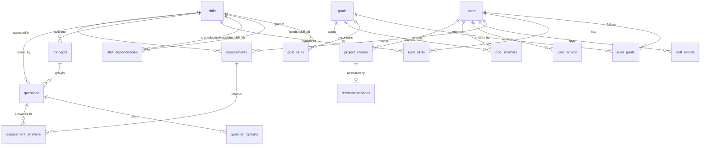

# Database

SkillGraph uses PostgreSQL 14 or newer. The schema is created by `backend/schema.sql` and extended by numbered migrations in `backend/migrations/`.

## Overview

## Tables

### Accounts and goals

| Table | Purpose | Notes |
| --- | --- | --- |
| `users` | Accounts | `email` is unique, password is stored only as a bcrypt hash, `role` is `USER`, `MENTOR` or `ADMIN` (`MENTOR` was added by migration 006), `weekly_hours` is 1 to 80 (migration 001) |
| `goals` | The 7 career goals | `name` is unique |
| `user_goals` | The goal a user follows | One row per user and goal. A partial unique index (`one_current_goal_per_user`) allows only one current goal per user |

### Skills and the graph

| Table | Purpose | Notes |
| --- | --- | --- |
| `skills` | The 44 skills shared by all goals | `name` is unique, `category` groups them on screen |
| `goal_skills` | Which skills belong to a goal | Holds `required_proficiency` (0 to 1), `importance` (0 to 1) and `estimated_hours` (0 or more) for that goal |
| `skill_dependencies` | Prerequisites (43 edges) | Directed edge `skill_id` needs `prerequisite_skill_id`. A skill cannot require itself |

A skill is shared, so its numbers live in `goal_skills` and can differ from goal to goal. Changing them for one goal does not affect the others.

### Progress

| Table | Purpose | Notes |
| --- | --- | --- |
| `user_skills` | Mastery of one user in one skill | `proficiency_level` and `confidence` between 0 and 1, `state` is one of `LOCKED`, `READY`, `LEARNING`, `PRACTICING`, `ASSESSING`, `MASTERED`, `NEEDS_VERIFICATION` |
| `skill_events` | History of what happened to a skill | `payload` is JSONB. Linked to an assessment when there is one |

Progress is stored per skill, not per goal. When a user changes goal, skills they share with the new goal keep their mastery.

### Advice

| Table | Purpose | Notes |
| --- | --- | --- |
| `user_advice` | A message an admin writes for a user (shown on the dashboard) | `message` is 1 to 1000 characters, `read_at` is empty until the user marks it as read. `admin_id` becomes empty if the admin account is deleted, the advice stays (migration 005) |

### Mentors

| Table | Purpose | Notes |
| --- | --- | --- |
| `goal_mentors` | Which mentors look after which goal | Primary key `(goal_id, mentor_id)`, so a link exists once. A goal can have several mentors and a mentor can have several goals. Only users with the role `MENTOR` are assigned (enforced by the mentor service). Deleted with the goal or with the mentor account (migration 006) |
| `project_shares` | A project a learner shares with a mentor of their goal | `status` is `PENDING`, `RECOMMENDED` or `DECLINED`. Title 3 to 120 and description 20 to 2000 characters. `mentor_id` becomes empty if the mentor account is deleted or stops being a mentor while the project waits. Deleted with the learner or the goal (migration 007) |
| `recommendations` | The signed recommendation a mentor wrote for one project | One per project (`share_id` is unique). Keeps the mentor name and title it was signed with, the text (at least 50 characters), the signature as a PNG data URL and a unique verification code such as `SG-7KQ2-M9XD-4TPA`. Deleted with its project (migration 007) |

### Assessments and questions

| Table | Purpose | Notes |
| --- | --- | --- |
| `concepts` | Sub-topics of a skill | Each has a `weight` (above 0, up to 1). The score of a skill is built from its concept scores |
| `questions` | The question bank (660 questions, 15 per skill) | `difficulty` is 1 (easy), 2 (medium) or 3 (hard). `(skill_id, prompt)` is unique. `is_active` hides a question (migration 003) |
| `question_options` | The 4 answers of a question | Exactly one is correct (enforced by the admin service) |
| `assessments` | One test of one user in one skill | `completed_at` is empty while the test is open. `final_score` is 0 to 100 |
| `assessment_answers` | The answer to each question | Primary key `(assessment_id, question_id)`, so a question is answered once per test |

The standard bank per skill is 15 questions: 5 easy, 5 medium and 5 hard. One assessment asks 10 of them, picked from the **active** questions only.

## Deleting data

Foreign keys decide what happens to related rows:

| Deleting | Also deletes | Keeps |
| --- | --- | --- |
| A user | Their goals, skill progress, assessments, answers, events, advice they received | Everything else |
| An admin | Nothing | The advice they wrote stays (the author becomes empty) |
| A goal | Its `goal_skills`, `user_goals` and `goal_mentors` rows | Skills and their questions |
| A mentor account | Their `goal_mentors` links | The goals, and the projects shared with them (their `mentor_id` becomes empty, signed recommendations stay) |
| A learner | Their `project_shares` and the recommendations of those projects | The mentors |
| A skill | Its concepts, questions, options, goal links, prerequisites, user progress, assessments | Goals |
| A question | Its options and the answers to it | The skill |
| A concept | Nothing | Its questions stay with `concept_id` empty |
| An assessment | Its answers | `skill_events` stay with `assessment_id` empty |

`assessment_answers.selected_option_id` has no cascade. An option that was answered cannot be deleted, so the admin service edits options in place instead of replacing them.

The admin pages never delete content that users already touched: questions are hidden (`is_active = FALSE`) and a skill removed from a goal is only unlinked in `goal_skills`.

## Constraints that protect the data

- Unique: user email, goal name, skill name, `(skill_id, prompt)`, `(skill_id, name)` for concepts
- Foreign keys on every link table
- `CHECK` ranges: mastery, confidence, required mastery and importance between 0 and 1, hours not negative, difficulty 1 to 3, assessment score 0 to 100, weekly hours 1 to 80, no skill is its own prerequisite
- Enums: `user_role`, `user_goal_status`, `skill_state`

`npm run test:db` checks all of these against a real PostgreSQL.

## Indexes

Created for the queries the app runs most (found with `EXPLAIN ANALYZE` on 20,000 users):

| Index | Query it speeds up |
| --- | --- |
| `idx_users_created_at` | Admin users list, newest first |
| `idx_assessments_user_completed` | Recent assessments and completed counts (finished tests only) |
| `idx_assessments_open` | Resuming an open assessment (unfinished tests only) |
| `idx_question_options_question` | Reading the options of a question |
| `idx_assessment_answers_option` | Checking answers that point to an option |
| `idx_questions_skill_active` | Reading the active questions of one skill |
| `idx_goal_skills_skill`, `idx_skill_deps_prereq`, `idx_user_skills_skill`, `idx_user_goals_goal` | Graph and recommendation queries |

## Migrations

Migrations are plain SQL files in `backend/migrations/`, applied in file name order by `npm run migrate` (or `migrate:prod` after a build). The server also applies pending ones on startup.

The runner records every applied file in the `schema_migrations` table, so each runs once. A first run on an empty database applies `000_baseline_schema` (`backend/schema.sql`) and then the numbered files.

| Migration | What it does |
| --- | --- |
| `000_baseline_schema` | Creates all tables, types and base indexes |
| `001_user_profile` | Adds `users.weekly_hours` |
| `002_performance_indexes` | Adds the indexes listed above |
| `003_admin_content` | Adds `questions.is_active` and its index |
| `004_remove_arabic_text` | Removes Arabic text that older versions stored in goal and skill descriptions (`English / Arabic`), keeping the English part |
| `005_user_advice` | Adds the `user_advice` table and its index |
| `006_mentors` | Adds the role `MENTOR` to `user_role` and the `goal_mentors` table with its index |
| `007_project_shares` | Adds the `project_shares` and `recommendations` tables with their indexes |

Rules for a new migration:

1. Add a file with the next number, for example `008_name.sql`.
2. Make it safe to read twice (`IF NOT EXISTS`) where PostgreSQL allows it.
3. Never edit a migration that was already merged. Add a new one instead.
4. Run `npm run migrate`, then `npm run test:db`.

## Seed data

`npm run seed` fills an empty database with 7 goals, 44 skills, 43 prerequisites and 660 questions. It is an initial load only:

- If the database already has content, it prints a message and writes nothing, so it never overwrites changes made by admins.
- `npm run seed -- --force` resets the content to the catalog in `backend/src/seed/`.
- In production use `npm run seed:prod` (and `seed:prod -- --force`) after `npm run build`.

`npm run check:seed` verifies the result: every skill has at least 10 active questions, the standard bank is 5 easy, 5 medium and 5 hard, the graph has no cycles, and every goal is reachable.

`npm run seed:demo` creates the demo accounts used in the presentation.